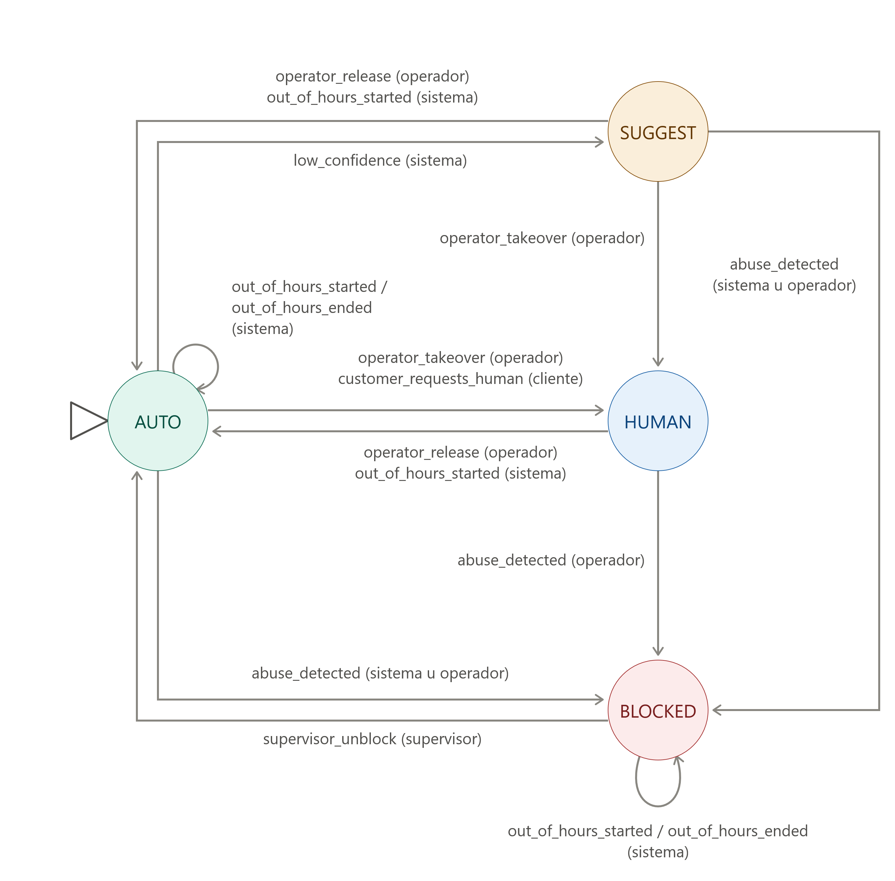

# Revisión de la especificación (Parte 3)

La consigna decía que la especificación podía tener errores, acá están los que encontré, por qué son un problema y cómo lo resolví. Todo está implementado en `src/agente_zoco/maquina/` y `agent.py`, y los tests están en `tests/test_maquina.py` y `tests/test_politicas.py`

Entre paréntesis está el actor que puede disparar cada evento. Fuera de horario cualquier evento que lleve a HUMAN o SUGGEST da error

| Estado | Herramientas | Respuesta |
|---|---|---|
| AUTO | las tres | se envía |
| SUGGEST | las tres | queda como borrador hasta que el operador la aprueba |
| HUMAN | ninguna | no se genera |
| BLOCKED | ninguna | no se genera |

## Errores en la tabla

1. `HUMAN + abuse_detected` tenía dos destinos (BLOCKED y HUMAN "el operador decide"), así la máquina no sabe cuál usar. Dejé una sola fila que va a BLOCKED pero solo la puede disparar el operador, así se respeta que decide él. Si la dispara el sistema da error

2. `BLOCKED + operator_release → AUTO` contradice la regla 4, que dice que solo un supervisor saca de BLOCKED. La saqué, de BLOCKED se sale solo con `supervisor_unblock` y con actor supervisor

3. `Cualquiera + out_of_hours_started → AUTO` incluye a BLOCKED, o sea desbloquea sin supervisor. BLOCKED queda en BLOCKED y para los demás estados puse cada fila por separado

4. No había un evento para cuando vuelve el horario, entonces la conversación quedaba fuera de horario para siempre. Agregué `out_of_hours_ended`. No vuelve sola al estado que tenía antes porque si era HUMAN capaz el operador todavía no está, si quiere la retoma con `operator_takeover`

5. Fuera de horario se podía pasar a HUMAN o SUGGEST, y la regla 3 dice que solo responde la IA. Ahora da error, y si es el cliente el que pide un humano el agente le responde con la franja de atención

## Ambigüedades

6. No dice cuál es la franja horaria. Puse de lunes a viernes de 9 a 18 h, está en `FRANJA_HUMANA`

7. No dice qué actor puede disparar cada evento, y sin eso la regla 4 no se puede garantizar. Cada fila de la tabla tiene sus actores permitidos y si no coincide da error

8. No dice quién detecta el abuso, la baja confianza o cuándo el cliente pide un humano. Los eventos llegan de afuera con `agente.evento()`, en la consola se simulan con `/evento` y la evaluación los usa igual

9. Eventos que no tienen sentido en el estado actual, por ejemplo `customer_requests_human` estando en HUMAN. Dan error y no se ignoran, como pide la consigna

## Cruce con la Parte 2

10. Si un operador toma el control con un reclamo a medio confirmar, un "sí" después lo registraría en HUMAN, y la regla 1 dice que ahí no se ejecutan acciones. Al pasar a HUMAN o BLOCKED el reclamo pendiente se descarta

11. En SUGGEST el mensaje de confirmación del reclamo también es un mensaje al cliente, así que es un borrador como todo lo demás

12. En SUGGEST el reclamo necesita dos aprobaciones y la consigna no dice el orden. Primero el operador aprueba la confirmación, el cliente dice "sí" y recién cuando el operador aprueba ese último borrador se guarda. Si lo rechaza no se guarda nada

13. Si el operador rechaza el pedido de confirmación el cliente nunca lo vio, entonces un "sí" después no vale. Rechazar un borrador descarta también el reclamo pendiente

14. Si llega otro mensaje con un borrador sin aprobar, el nuevo reemplaza al viejo y se descarta el reclamo pendiente

15. Si se sale de SUGGEST con un borrador sin aprobar se descarta, lo que el operador no aprobó nunca se envía

16. Si `crear_reclamo` falla después de que el operador aprueba, el reclamo queda pendiente y el reintento vuelve a pasar por el operador. La clave del reclamo evita que se guarde dos veces

## Limitaciones

- Los mensajes del operador no quedan en el historial, al volver a AUTO el modelo no sabe qué se habló
- El registro de transiciones vive en memoria, no se guarda en disco
- El horario se maneja con eventos, no con el reloj
